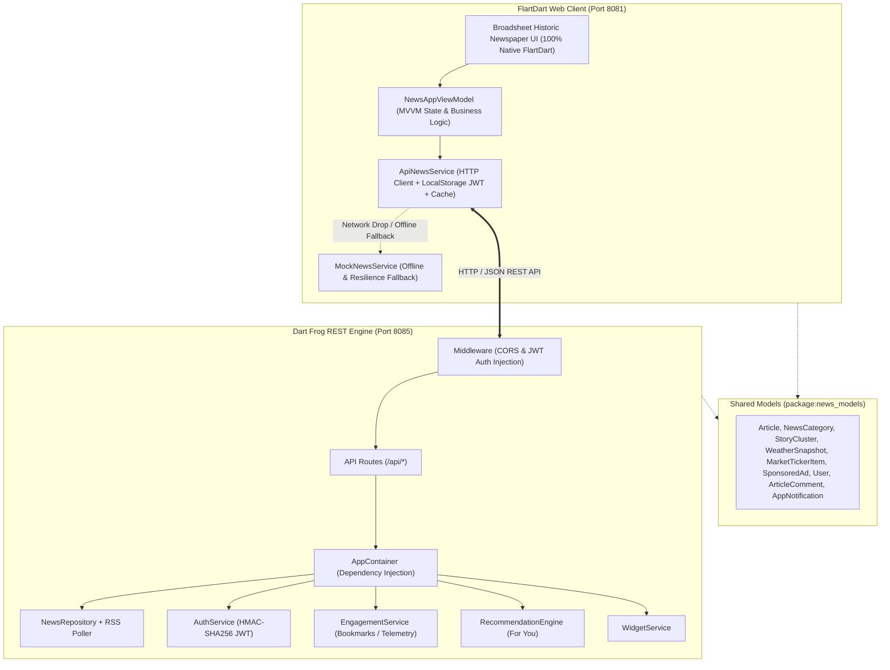

# ReadMore Backend Architecture & REST API Documentation

This document provides the complete technical reference for the **ReadMore** Dart Frog backend API (`http://localhost:8085/api`), data contracts, authentication, and end-to-end FlartDart web client integration (`http://localhost:8081`).

---

## 1. System Architecture Overview



---

## 2. Server Configuration & Middleware

- **Backend Port:** `8085` (avoids common Windows `svchost` bindings on `:8080`; CORS enabled for `*`, supporting `localhost:8081`).
- **Base URI:** `http://localhost:8085/api`
- **Authentication Scheme:** Bearer Token via standard HTTP header:
  ```http
  Authorization: Bearer <jwt_token>
  ```
- **Session Persistence:** JWT tokens persist in browser `localStorage` (`readmore_jwt_token`) via conditional web/stub storage (`web/lib/data/services/token_storage.dart`) and re-validate on startup via `GET /api/auth/me`.

---

## 3. API Endpoints Reference

### 3.1 Articles, Feeds, Clusters & Search

| Method & Route | Query / Body Parameters | Response Envelope |
|---|---|---|
| `GET /api/news` | `category`, `country`, `city`, `source`, `tag`, `sortBy` (`latest`, `popular`, `most_read`, `trending`, `likes`), `limit`, `offset` | `{ "count": int, "total": int, "offset": int, "limit": int, "hasMore": bool, "category": string, "sortBy": string, "articles": [...] }` |
| `GET /api/news/search` | `q`, `category`, `source`, `country`, `city`, `sortBy`, `limit`, `offset` | `{ "query": string, "count": int, "total": int, "offset": int, "limit": int, "hasMore": bool, "articles": [...] }` |
| `GET /api/news/for_you` | `topics` (CSV), `city`, `country`, `limit`, `offset` (also uses authenticated `UserPreferences` + dwell/click affinities) | `{ "count": int, "isPersonalized": true, "user": "authenticated"\|"guest", "followedTopics": [...], "articles": [...] }` |
| `GET /api/news/local` | `city`, `country`, `limit` | `{ "location": {"city": ..., "country": ...}, "count": int, "articles": [...] }` |
| `GET /api/news/breaking` | — | `{ "count": int, "isBreaking": true, "articles": [...] }` |
| `GET /api/news/trending` | `limit` | `{ "count": int, "trending": true, "articles": [...] }` |
| `POST /api/news/refresh` | — (triggers concurrent RSS ingestion) | `{ "message": ..., "newArticlesIngested": int, "totalArticlesInStore": int }` |
| `GET /api/news/:id` | Path `id` (or slug); increments backend `viewCount` & generates Schema.org JSON-LD + meta tags | `{ "article": {...}, "seo": { "schemaJsonLd": ..., "metaTagsHtml": ... } }` |
| `GET /api/news/clusters` | — | `{ "count": int, "description": ..., "clusters": [...] }` |
| `GET /api/news/clusters/:id` | Path `id` | `{ "cluster": {...} }` |
| `GET /api/categories` | — | `{ "categories": [...] }` |

---

### 3.2 Community Comments

| Method & Route | Payload | Response Envelope |
|---|---|---|
| `GET /api/news/:id/comments` | Path `id` | `{ "articleId": id, "count": int, "comments": [...] }` |
| `POST /api/news/:id/comments` | `{ "author": ..., "avatarUrl": ..., "text": ... }` | `201`: `{ "message": ..., "comment": {...} }` |
| `POST /api/comments/like` | `{ "commentId": ... }` | `{ "commentId": ..., "isLiked": bool, "message": ... }` |

---

### 3.3 Weather, Markets & Trending Topics Widgets

| Method & Route | Query Parameters | Response Envelope |
|---|---|---|
| `GET /api/widgets/weather` | `city` (`New York`, `London`, `Tokyo`, `Paris`, `Lagos`, `San Francisco`), `lat`, `lng` | `{ "weather": { "city": ..., "temperatureC": ..., "condition": ..., "stationCode": ..., "airQualityIndex": ..., "forecast": [...] } }` |
| `GET /api/widgets/markets` | `sector` (`All`, `Indices`, `Crypto`, `Tech`, `Tech Equities`, `Energy`, `Commodities`, `Currencies`) | `{ "sector": ..., "count": int, "markets": [...] }` |
| `GET /api/widgets/trending` | — | `{ "trendingTopics": [...] }` |

---

### 3.4 Sponsored Ads & Click Telemetry

| Method & Route | Payload / Query | Response Envelope |
|---|---|---|
| `GET /api/ads` | Query: `placement`, `category`, `format` | `{ "count": int, "ads": [...] }` |
| `POST /api/ads` | `SponsoredAd` JSON body | `201`: `{ "message": ..., "ad": {...} }` |
| `POST /api/ads/click` | `{ "adId": ... }` | `{ "adId": ..., "status": "recorded" }` |

---

### 3.5 Authentication, User Collections, Preferences & Subscriptions

*Seeded Demo Credentials:* `demo@readmore.com` / `Password123!`

| Method & Route | Auth Required | Payload / Query | Response Envelope |
|---|---|---|---|
| `POST /api/auth/register` | No | `{ "email", "password", "displayName", "avatarUrl"? }` | `201`: `{ "message", "token", "user" }` |
| `POST /api/auth/login` | No | `{ "email", "password" }` | `{ "token", "user" }` |
| `POST /api/auth/google` | No | `{ "email"?, "displayName"?, "avatarUrl"? }` | `{ "token", "user" }` |
| `GET /api/auth/me` | Yes (Bearer JWT) | — | `{ "user": {...} }` |
| `GET /api/user/bookmarks` | Yes (Bearer JWT) | `limit`, `offset` | `{ "count": int, "bookmarks": [...] }` |
| `POST /api/user/bookmarks` | Yes (Bearer JWT) | `{ "articleId": ... }` | `201`: `{ "message", "item" }` |
| `DELETE /api/user/bookmarks` | Yes (Bearer JWT) | Query: `articleId` | `{ "message", "success": bool }` |
| `GET /api/user/read_later` | Yes (Bearer JWT) | `limit`, `offset` | `{ "count": int, "readLater": [...] }` |
| `POST /api/user/read_later` | Yes (Bearer JWT) | `{ "articleId": ... }` | `201`: `{ "message", "item" }` |
| `DELETE /api/user/read_later` | Yes (Bearer JWT) | Query: `articleId` | `{ "message", "success": bool }` |
| `POST /api/user/interaction` | Optional | `{ "articleId", "type", "dwellTimeSeconds"? }` | `{ "message", "articleId", "type", "dwellTimeSeconds" }` |
| `GET /api/user/preferences` | Yes (Bearer JWT) | — | `{ "preferences": {...} }` |
| `PUT /api/user/preferences` | Yes (Bearer JWT) | `{ "displayName"?, "followedTopics"?, "locationCity"?, "locationCountry"?, "enableBreakingAlerts"?, "enableDailyBriefing"?, "audioAutoplay"? }` | `{ "message", "preferences": {...}, "user": {...} }` |
| `GET /api/user/subscription` | Yes (Bearer JWT) | — | `{ "userId", "subscriptionTier", "isPro", "adFreeEnabled" }` |
| `POST /api/user/subscription` | Yes (Bearer JWT) | `{ "plan": "annual", "paymentMethod": "Google Pay" }` | `{ "message", "user": {...} }` |
| `DELETE /api/user/subscription` | Yes (Bearer JWT) | — | `{ "message", "user": {...} }` |
| `POST /api/user/toggle_ad_free` | Yes (Bearer JWT) | — | `{ "message", "adFreeEnabled": bool, "user": {...} }` |

---

### 3.6 Real-Time Dispatch Notifications

| Method & Route | Payload | Response Envelope |
|---|---|---|
| `GET /api/notifications` | — | `{ "count": int, "notifications": [...] }` |
| `POST /api/notifications` | `{ "id": ... }` | `{ "message": "Marked as read" }` |

---

## 4. Verification & Local Launch

- **Backend server:** `cd backend && dart_frog dev --port 8085`
- **Web client:** `cd web && dart run build_runner serve web:8081 --hostname 0.0.0.0`
- **Integration suite:** `cd web && dart test test/api_news_service_test.dart`
