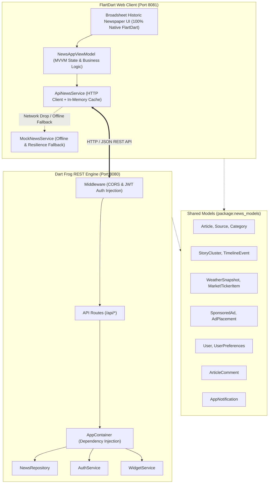

# ReadMore Backend Architecture & REST API Documentation

This document provides a comprehensive technical reference for the **ReadMore** Dart Frog backend API, data models, query parameter capabilities, and the resilient frontend integration layer implemented in FlartDart.

---

## 1. System Architecture Overview



---

## 2. Server Configuration & Middleware

- **Default Port:** `8080` (CORS headers enabled for `*`, supporting `localhost:8081`).
- **Base URI:** `http://localhost:8080/api`
- **Authentication Scheme:** Bearer Token via standard HTTP header:
  ```http
  Authorization: Bearer <jwt_token>
  ```
- **Content-Type:** `application/json; charset=utf-8`

---

## 3. API Endpoints Reference

### 3.1 Articles & News Engine

#### `GET /api/news`
Fetches a paginated, filterable collection of articles.

- **Query Parameters:**
  | Parameter | Type | Required | Default | Description |
  |---|---|---|---|---|
  | `category` | `string` | No | `all` | Filter by category (e.g. `top`, `world`, `business`, `technology`, `science`, `local`) |
  | `city` | `string` | No | — | Filter local news by city name (e.g. `New York`, `London`, `Tokyo`, `Paris`, `Lagos`) |
  | `source` | `string` | No | `all` | Filter by publisher slug (e.g. `reuters`, `bloomberg`, `ap-news`) |
  | `tag` | `string` | No | — | Filter by topical tag (e.g. `CleanEnergy`, `WallStreet`, `AI`) |
  | `sortBy` | `string` | No | `latest` | Sort order: `latest`, `popular`, `trending`, `views`, `likes` |
  | `limit` | `int` | No | `20` | Max items per page |
  | `offset` | `int` | No | `0` | Pagination start index |

- **Sample Response (200 OK):**
  ```json
  {
    "total": 42,
    "offset": 0,
    "limit": 20,
    "hasMore": true,
    "category": "business",
    "articles": [
      {
        "id": "art-bus-1",
        "title": "Federal Reserve Signals Measured Policy Stance Amid Sustained Productivity Gains",
        "summary": "Central bankers maintain current reference rate corridor while highlighting capital investment acceleration.",
        "content": "Full multi-paragraph broadsheet journalism content...",
        "category": "business",
        "source": {
          "id": "src-bloomberg",
          "name": "Bloomberg",
          "slug": "bloomberg",
          "credibilityScore": 0.96
        },
        "author": "Marcus Vance",
        "publishedAt": "2026-11-24T14:30:00Z",
        "readTimeMinutes": 5,
        "likeCount": 1840,
        "viewCount": 24900,
        "tags": ["FederalReserve", "InterestRates", "Economy", "Markets"]
      }
    ]
  }
  ```

---

#### `GET /api/news/search`
Deep full-text search across article titles, summaries, content, sources, and tags.

- **Query Parameters:**
  | Parameter | Type | Required | Default | Description |
  |---|---|---|---|---|
  | `q` | `string` | Yes | — | Search query string |
  | `category` | `string` | No | `all` | Filter results by category |
  | `source` | `string` | No | `all` | Filter results by source slug |
  | `country` | `string` | No | — | Filter by country code |
  | `city` | `string` | No | — | Filter by city name |
  | `sortBy` | `string` | No | `latest` | Sort order (`latest`, `popular`, `trending`) |
  | `limit` | `int` | No | `20` | Max items |
  | `offset` | `int` | No | `0` | Offset |

- **Sample Response (200 OK):**
  ```json
  {
    "query": "clean energy",
    "total": 5,
    "offset": 0,
    "limit": 20,
    "hasMore": false,
    "articles": [ ... ]
  }
  ```

---

#### `GET /api/news/[id]`
Retrieves full details for a single article by ID.
- **Path Parameter:** `id` (e.g. `art-hero-1`)
- **Response (200 OK):** `Article` JSON object.
- **Error (404 Not Found):** `{"error": "Article not found"}`

---

#### `GET /api/news/clusters` & `GET /api/news/clusters/[id]`
Google News "Full Coverage" topic clusters grouping diverse editorial perspectives and a chronological timeline.
- **Sample Cluster Object:**
  ```json
  {
    "id": "cluster-climate-2026",
    "topicHeadline": "Global Climate Accord 2026: Historic Renewable Energy Treaty",
    "category": "world",
    "primaryArticle": { ... },
    "alternativePerspectives": [ ... ],
    "timeline": [
      {
        "time": "08:00 AM",
        "title": "Summit Convenes in Geneva",
        "summary": "Delegates from 195 nations assemble for plenary session.",
        "sourceName": "Reuters"
      }
    ],
    "updatedAt": "2026-11-24T16:00:00Z"
  }
  ```

---

### 3.2 Community & Verified Reader Comments

#### `GET /api/news/[id]/comments`
Retrieves chronological discussion thread for an article.
- **Path Parameter:** `id` (article identifier)
- **Sample Response (200 OK):**
  ```json
  [
    {
      "id": "c-101",
      "author": "Dr. Aris Thorne",
      "avatarUrl": "https://images.unsplash.com/photo-1534528741775-53994a69daeb",
      "text": "The cross-border transmission grid mandate is the true breakthrough here.",
      "timeAgo": "1h ago",
      "likes": 24,
      "isLiked": false,
      "createdAt": "2026-11-24T15:30:00Z"
    }
  ]
  ```

#### `POST /api/news/[id]/comments`
Submits a verified reader comment.
- **Request Body:**
  ```json
  {
    "author": "Eleanor Vance",
    "avatarUrl": "https://images.unsplash.com/...",
    "text": "The public-private guarantee framework will accelerate adoption."
  }
  ```
- **Response (201 Created):** Created `ArticleComment` JSON.

#### `POST /api/comments/like`
Upvotes or unlikes an existing comment.
- **Request Body:**
  ```json
  { "commentId": "c-101" }
  ```
- **Response (200 OK):**
  ```json
  {
    "success": true,
    "comment": { "id": "c-101", "likes": 25, "isLiked": true }
  }
  ```

---

### 3.3 Financial Markets & Weather Widgets

#### `GET /api/widgets/weather`
Multi-city meteorological profiles with 3-day forecasts.
- **Query Parameters:** `city` (`New York`, `London`, `Tokyo`, `Paris`, `Lagos`, `San Francisco`)
- **Sample Response (200 OK):**
  ```json
  {
    "city": "New York",
    "tempC": 22.0,
    "condition": "Partly Cloudy",
    "stationCode": "NYC-CENTRAL",
    "airQualityIndex": 38,
    "forecast": [
      { "day": "Tue", "tempC": 24.0, "condition": "Sunny" },
      { "day": "Wed", "tempC": 19.0, "condition": "Rain" },
      { "day": "Thu", "tempC": 21.0, "condition": "Partly Cloudy" }
    ]
  }
  ```

#### `GET /api/widgets/markets`
Sector-filtered financial market tickers with sparkline trend data.
- **Query Parameters:** `sector` (`All`, `Indices`, `Crypto`, `Tech`, `Energy`, `Currencies`)
- **Sample Response (200 OK):**
  ```json
  {
    "sector": "Tech",
    "items": [
      {
        "symbol": "NVDA",
        "name": "NVIDIA Corp.",
        "value": 148.90,
        "changePercent": 2.45,
        "sector": "Tech",
        "sparkline": [142.1, 144.5, 146.0, 148.9]
      }
    ]
  }
  ```

#### `GET /api/widgets/trending`
- **Response (200 OK):** Array of trending topics:
  ```json
  ["ClimateAccord2026", "FederalReserve", "QuantumComputing", "Bitcoin100k", "CleanGrid"]
  ```

---

### 3.4 Sponsored Ads & Campaign Monetization

#### `GET /api/ads`
Query active sponsored campaigns by placement and audience.
- **Query Parameters:** `placement` (`leaderboardBanner`, `inFeedNative`, `sidebarRectangle`), `category`, `format`
- **Sample Response (200 OK):**
  ```json
  {
    "ads": [
      {
        "id": "ad-lead-1",
        "sponsorName": "Vanguard Financial",
        "title": "Institutional Grade Wealth Architecture",
        "description": "Preserve generational capital with algorithmic global macro hedges.",
        "placement": "leaderboardBanner",
        "targetCategory": "all",
        "format": "banner",
        "ctaText": "Explore Portfolio",
        "ctaUrl": "https://example.com/vanguard",
        "impressions": 14200,
        "clicks": 680,
        "isActive": true
      }
    ]
  }
  ```

#### `POST /api/ads`
Publish a new self-serve advertiser campaign.
- **Request Body:** `SponsoredAd` JSON.
- **Response (201 Created):** `{"success": true, "ad": { ... }}`

#### `POST /api/ads/click`
Logs click telemetry for publisher revenue accounting.
- **Request Body:** `{"adId": "ad-lead-1"}`
- **Response (200 OK):** `{"success": true, "clicks": 681}`

---

### 3.5 User Authentication & Pro Subscription

#### `POST /api/auth/register` & `POST /api/auth/login`
- **Request Body:**
  ```json
  {
    "email": "reader@broadsheet.org",
    "password": "secret_password_123",
    "displayName": "Alexander Hamilton"
  }
  ```
- **Response (200 OK / 201 Created):**
  ```json
  {
    "token": "eyJhbGciOiJIUzI1NiIsInR5cCI6IkpXVCJ9...",
    "user": {
      "id": "usr-1",
      "email": "reader@broadsheet.org",
      "displayName": "Alexander Hamilton",
      "subscriptionTier": "free",
      "adFreeEnabled": false
    }
  }
  ```

#### `POST /api/user/subscription`
Upgrades user subscription (e.g. to Pro).
- **Headers:** `Authorization: Bearer <token>`
- **Request Body:**
  ```json
  {
    "plan": "annual",
    "paymentMethod": "Google Pay"
  }
  ```
- **Response (200 OK):** `{"success": true, "user": { ... }}`

#### `POST /api/user/toggle_ad_free`
Allows Pro subscribers to toggle between pristine ad-free and sponsor-supported views.
- **Headers:** `Authorization: Bearer <token>`
- **Response (200 OK):** `{"success": true, "adFreeEnabled": true}`

---

### 3.6 Real-Time Dispatch Notifications

#### `GET /api/notifications`
Returns current system and breaking news dispatches.
- **Sample Response (200 OK):**
  ```json
  {
    "notifications": [
      {
        "id": "notif-1",
        "title": "BREAKING: Global Climate Summit concludes with historic clean energy treaty.",
        "timeAgo": "25m ago",
        "isBreaking": true,
        "articleId": "art-hero-1",
        "isRead": false
      }
    ]
  }
  ```

#### `POST /api/notifications`
Marks a notification as read.
- **Request Body:** `{"id": "notif-1"}`
- **Response (200 OK):** `{"success": true, "notification": { "id": "notif-1", "isRead": true }}`

---

## 4. Frontend Integration Blueprint (`ApiNewsService`)

The web frontend uses the **MVVM Pattern** with a two-tier resilience strategy:

1. **Instant Synchronous Read:** FlartDart widgets read cached domain models synchronously through `NewsAppViewModel` getters (`headlinesArticles`, `currentWeather`, `marketTickers`, etc.), guaranteeing 0ms paint latency and zero rendering flashes.
2. **Background Reactive Sync:** When users interact with the app (switching categories, cities, market sectors, searching, commenting, or upgrading), `NewsAppViewModel` triggers `ApiNewsService` asynchronous methods in the background. As soon as responses arrive, `notifyListeners()` updates the view reactively.
3. **Resilient Fallback:** If the backend is offline or an API request fails, `ApiNewsService` catches the network error transparently and falls back to local data, guaranteeing that the application **never crashes**.

---

## 5. Verification Status

| Component | Directory | Command | Status |
|---|---|---|---|
| Shared Models | `packages/news_models` | `dart analyze` | Clean (0 issues) |
| Backend Engine | `backend` | `dart analyze` | Clean (0 errors) |
| Web Application | `web` | `dart analyze --no-fatal-warnings` | Clean (0 errors) |
| Web Dev Server | `web` | `build_runner serve web:8081` | Running & Verified |
